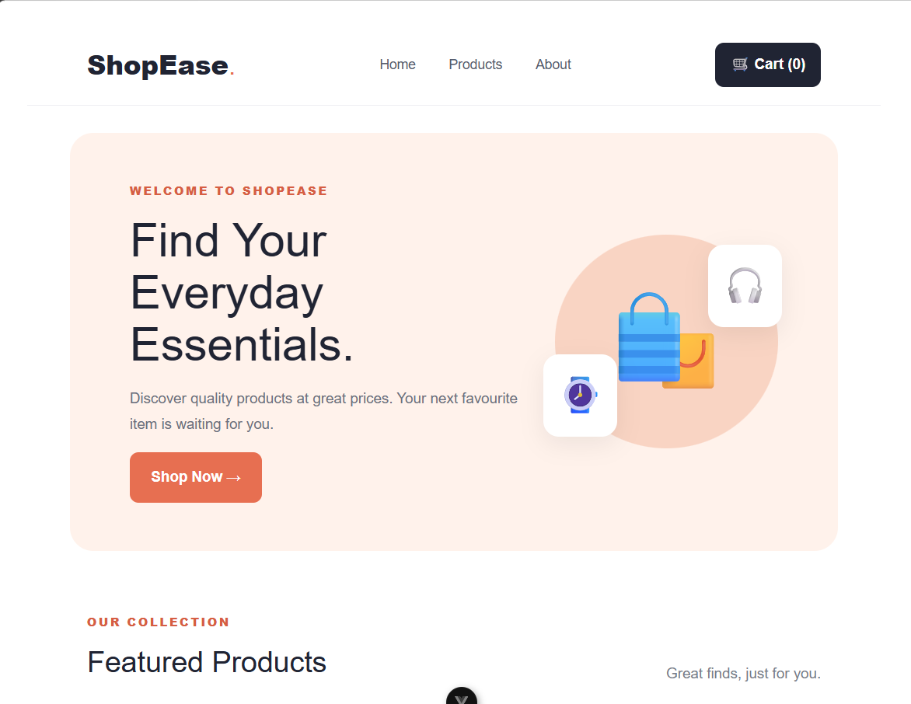
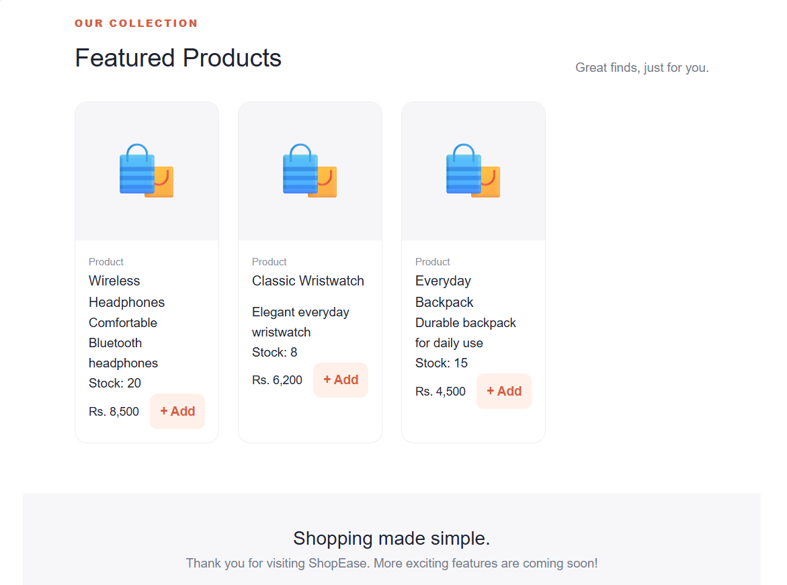
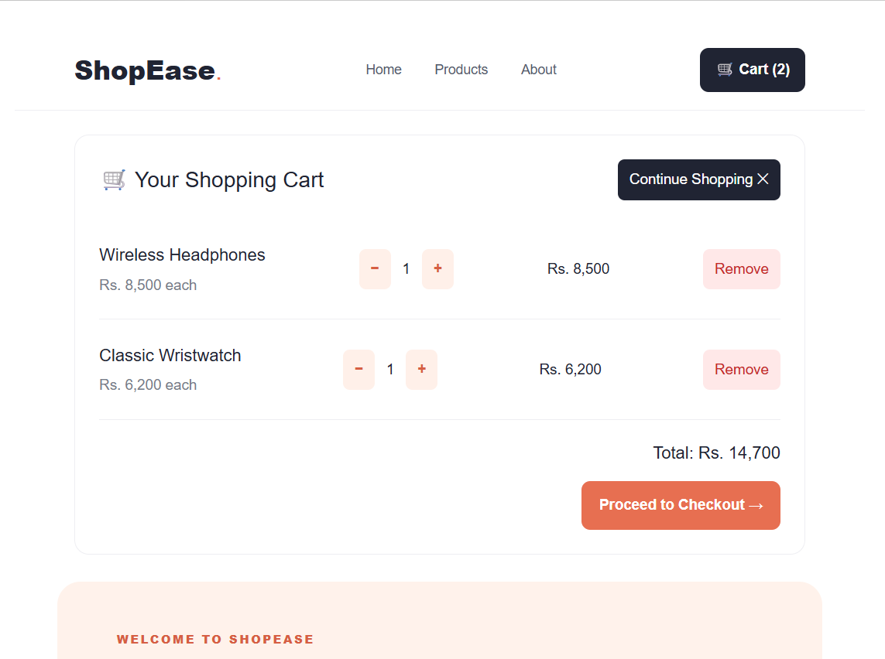
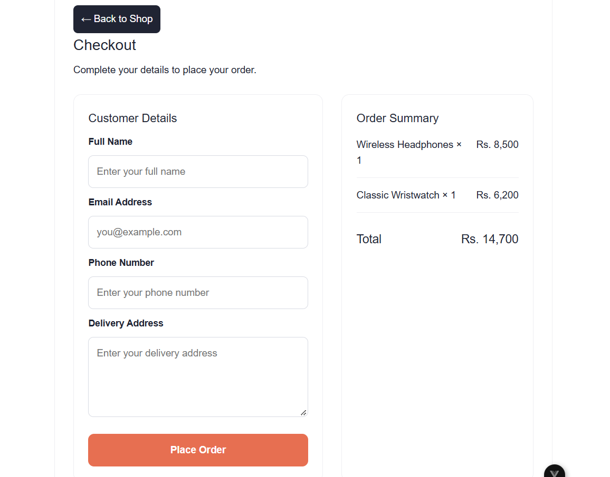
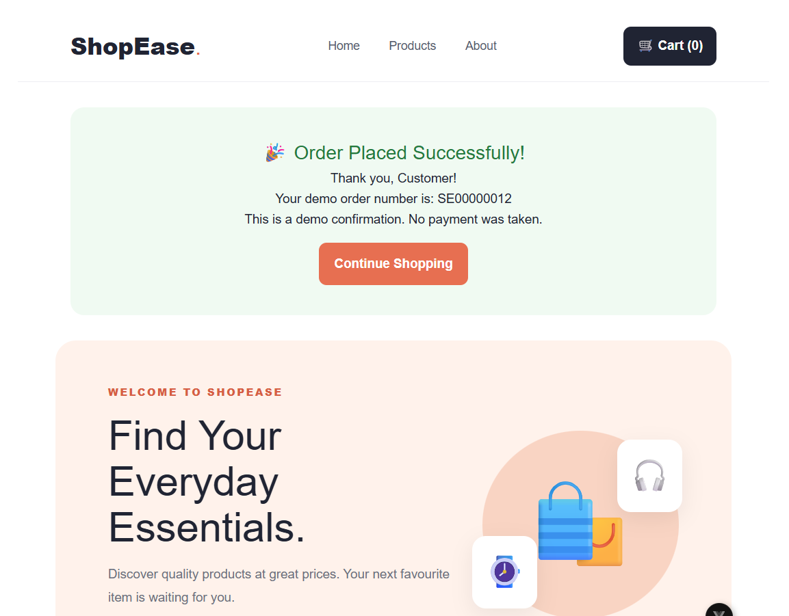

\# ShopEase – E-Commerce Web Application


ShopEase is a full-stack e-commerce web application developed using ASP.NET Core Web API, Vue.js, and Microsoft SQL Server. It allows customers to browse products, manage a shopping cart, and place orders online.


\## Features


\- Product listing and product details

\- Shopping cart management

\- Add and remove products from the cart

\- Quantity and stock validation

\- Customer checkout form

\- Order placement and database storage

\- Automatic stock deduction after successful orders

\- Order total calculation

\- Order status management


\## Technologies Used


\*\*Frontend\*\*

\- Vue.js

\- JavaScript

\- HTML5

\- CSS3

\- Vite


\*\*Backend\*\*

\- C#

\- ASP.NET Core Web API

\- Entity Framework Core


\*\*Database\*\*

\- Microsoft SQL Server Express


\*\*Tools\*\*

\- Visual Studio

\- Visual Studio Code

\- SQL Server Management Studio

\- Postman

\- Git and GitHub


\## Project Structure


```text

ECommerce/

│

├── ECommerce.API/

│   ├── Controllers/

│   ├── Data/

│   ├── Migrations/

│   ├── Models/

│   ├── Program.cs

│   └── appsettings.json

│

├── ecommerce-frontend/

│   ├── public/

│   ├── src/

│   ├── package.json

│   └── vite.config.js

│

├── .gitignore

└── README.md

```


\## Installation and Setup


\### 1. Clone the Repository


```bash

git clone YOUR\_GITHUB\_REPOSITORY\_URL

cd ECommerce

```


\### 2. Backend Setup


\- Open the `ECommerce.API` folder.

\- Configure the SQL Server connection string in `appsettings.Development.json`.

\- Create or configure the `ECommerceDB` database.

\- Apply Entity Framework Core migrations:


```bash

dotnet ef database update

```


\- Run the backend:


```bash

dotnet run

```


The API runs at:


`http://localhost:5008`


\### 3. Frontend Setup


Open a terminal inside the `ecommerce-frontend` folder.


Install dependencies:


```bash

npm install

```


Run the application:


```bash

npm run dev

```


Open the frontend in your browser:


`http://localhost:5173`


\## API Endpoints


| Method | Endpoint | Description |

|---|---|---|

| GET | `/api/Products` | Retrieve products |

| GET | `/api/Orders` | Retrieve orders |

| GET | `/api/Orders/{id}` | Retrieve a specific order |

| POST | `/api/Orders` | Place a new order |


\## Database


The application uses Microsoft SQL Server with Entity Framework Core.


Main database tables:


\- Products

\- Orders

\- OrderItems


\## Future Improvements


\- User authentication and authorization

\- Online payment integration

\- Product search and filtering

\- Order history for customers

\- Admin dashboard


\## Project Status


Core e-commerce functionality implemented and tested locally. Further improvements are planned.

## Application Screenshots

### Home Page


### Products Page


### Shopping Cart


### Checkout Page


### Order Success Page

